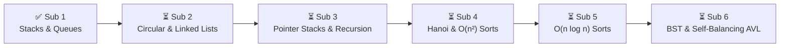

# 🚀 Data Structures & Algorithms (DSA) — データ構造とアルゴリズム


> 🎯 **Interactive Bilingual Repository (`EN` / `JA`)** — Built by **Bihandu Vindiv Hettiarachchi** at **Lanka Nippon BizTech Institute (LNBTI)** for `CMP210130_SE06/07` (CA3 GitHub Submissions).
>
> 🎯 **バイリンガル・リポジトリ（英語・日本語）** — **Lanka Nippon BizTech Institute (LNBTI)** の講義 `CMP210130_SE06/07`（CA3課題）向けに作成した、視覚的に学べるJavaデータ構造・アルゴリズム実装集です。

---

## 📊 Overall CA3 Progress Tracker / 課題進捗トラッカー

```text
CA3 Roadmap Progress: [████░░░░░░░░░░░░░░░░] 17.4% (4 / 23 Implementations Live)

✅ Submission 1 : Stacks, Queues & Dynamic Arrays   [████] 4/4 Done
⏳ Submission 2 : Circular Queues & Linked Lists    [░░░░] 0/4 Upcoming
⏳ Submission 3 : Circular Lists, Stacks & Recursion[░░░░] 0/4 Upcoming
⏳ Submission 4 : Hanoi Tower & Elementary Sorts    [░░░░] 0/4 Upcoming
⏳ Submission 5 : Advanced & Divide-and-Conquer Sort[░░░░] 0/4 Upcoming
⏳ Submission 6 : Optimized QuickSort, BST & AVL    [░░░ ] 0/3 Upcoming
```



---

## 🌐 English Version

### 👋 About This Repository

Hi, I'm **Bihandu Vindiv Hettiarachchi**! I created [bihanduvindiv/DSA](https://github.com/bihanduvindiv/DSA) to document and visualize my Java implementations for our **CA3 GitHub Submissions** in `CMP210130_SE06/07`.

Instead of treating these files like plain textbook exercises, I designed this repository as a visual handbook showing **how data structures behave in memory** and **why operation trade-offs matter**:
- ⚡ **Speed vs. Work Placement**: Making a structure `Push-Friendly` ($O(1)$ write) vs. `Pop-Friendly` ($O(1)$ read).
- 🧠 **Smart Memory Scaling**: Growing and shrinking arrays dynamically so programs neither crash nor waste RAM.

---

### 🎨 Visual Architecture: How Submission 1 Works Under the Hood

#### 1️⃣ `QueueStack` — Push-Friendly vs. Pop-Friendly Trade-off

```text
┌─────────────────────────────────────────────────────────────────────────┐
│ ⚡ PUSH-FRIENDLY (QueueStack_PushFriendly.java)                         │
│                                                                         │
│   push(x) ──► [ Enqueue directly to Q1 ] ──► 🟢 O(1) Instant!           │
│   pop()   ──► [ Move n-1 items Q1 ──► Q2, return last, swap Q1/Q2 ]     │
│                                          ──► 🟠 O(n) Work on Pop        │
├─────────────────────────────────────────────────────────────────────────┤
│ ⚡ POP-FRIENDLY (QueueStack_PopFriendly.java)                           │
│                                                                         │
│   push(x) ──► [ Enqueue x to Q2, pour all Q1 ──► Q2, swap Q1/Q2 ]       │
│                                          ──► 🟠 O(n) Work on Push       │
│   pop()   ──► [ Dequeue directly from front of Q1 ] ──► 🟢 O(1) Instant!│
└─────────────────────────────────────────────────────────────────────────┘
```

#### 2️⃣ `UnboundedArrayStack` — Dynamic Doubling & Halving

```text
  [Push When Full: Capacity × 2]
  ┌───┬───┬───┬───┐          ┌───┬───┬───┬───┬───┬───┬───┬───┐
  │ 10│ 20│ 30│ 40│ + push() │ 10│ 20│ 30│ 40│ 50│ · │ · │ · │  🟢 Amortized O(1)
  └───┴───┴───┴───┘ ───────► └───┴───┴───┴───┴───┴───┴───┴───┘

  [Pop When Sparse: Capacity ÷ 2]
  ┌───┬───┬───┬───┬───┬───┬───┬───┐          ┌───┬───┬───┬───┐
  │ 10│ 20│ · │ · │ · │ · │ · │ · │ + pop()  │ 10│ · │ · │ · │  🧠 Saves Memory!
  └───┴───┴───┴───┴───┴───┴───┴───┘ ───────► └───┴───┴───┴───┘
```

#### 3️⃣ `StackQueue` — Enqueue-Friendly FIFO Pipeline

```text
  enqueue(x) ──► [ Push to Stack 1 (Inbox) ]  ──► 🟢 O(1) Fast Write
  
  dequeue()  ──► [ Pour Stack 1 ──► Stack 2 (Outbox) ] ──► Pop Top ──► 🟠 O(n)
                 (Reverses LIFO order twice = FIFO Queue order!)
```

---

### 🗂️ CA3 Submission Roadmap & File Directory

> 💡 **Complexity Legend**: `🟢 O(1)` Constant | `🟡 O(log n)` Logarithmic | `🔵 O(n log n)` Linearithmic | `🟠 O(n)` Linear | `🔴 O(n²)` Quadratic

| Sub | Topic / Data Structure & Algorithm | File Name in Repository | Time Complexity & Key Focus | Status |
| :--- | :--- | :--- | :--- | :--- |
| **Sub 1** | **QueueStack — Push Friendly** | [QueueStack\_PushFriendly.java](https://www.google.com/search?q=https://github.com/bihanduvindiv/DSA/blob/main/QueueStack_PushFriendly.java) | `🟢 Push: O(1)` · `🟠 Pop: O(n)` — LIFO stack using two queues; shifts elements only on pop. | ✅ Done |
| **Sub 1** | **QueueStack — Pop Friendly** | [QueueStack\_PopFriendly.java](https://www.google.com/search?q=https://github.com/bihanduvindiv/DSA/blob/main/QueueStack_PopFriendly.java) | `🟠 Push: O(n)` · `🟢 Pop: O(1)` — Reorders elements during push for instant top retrieval. | ✅ Done |
| **Sub 1** | **Unbounded Array Stack** | [UnboundedArrayStack.java](https://www.google.com/search?q=https://github.com/bihanduvindiv/DSA/blob/main/UnboundedArrayStack.java) | `🟢 Amortized O(1)` — Dynamically expands and shrinks array capacity during push and pop. | ✅ Done |
| **Sub 1** | **StackQueue — Enqueue Friendly** | [StackQueue\_EnqueueFriendly.java](https://www.google.com/search?q=https://github.com/bihanduvindiv/DSA/blob/main/StackQueue_EnqueueFriendly.java) | `🟢 Enqueue: O(1)` · `🟠 Dequeue: O(n)` — FIFO queue built from two LIFO stacks. | ✅ Done |
| **Sub 2** | **StackQueue — Dequeue Friendly** | `StackQueue_DequeueFriendly.java` | `🟠 Enqueue: O(n)` · `🟢 Dequeue: O(1)` — Pre-orders stacks so dequeue is instant. | ⏳ Next |
| **Sub 2** | **Array Circular Queue** | `ArrayCircularQueue.java` | `🟢 Enqueue/Dequeue: O(1)` — Ring buffer using `(rear + 1) % capacity` wrap-around. | ⏳ Next |
| **Sub 2** | **Singly Linked List** | `SinglyLinkedList.java` | `🟢 Head Insert: O(1)` · `🟠 Search: O(n)` — Forward-pointer dynamic node chain. | ⏳ Next |
| **Sub 2** | **Doubly Linked List** | `DoublyLinkedList.java` | `🟢 Ends: O(1)` — Bidirectional nodes (`prev` & `next`) for two-way traversal. | ⏳ Next |
| **Sub 3** | **Circular Doubly Linked List** | `CircularDoublyLinkedList.java` | `🟢 Ends: O(1)` — Closed-loop bidirectional list connecting `tail.next` to `head`. | ⏳ Planned |
| **Sub 3** | **Linked List Stack** | `LinkedListStack.java` | `🟢 Push/Pop: O(1)` — Pointer-based LIFO stack with zero array-resizing overhead. | ⏳ Planned |
| **Sub 3** | **Linked List FIFO Queue** | `LinkedListFIFOQueue.java` | `🟢 Enqueue/Dequeue: O(1)` — Pointer-based queue tracking `front` and `rear` nodes. | ⏳ Planned |
| **Sub 3** | **Rabbit Problem** | `RabbitProblem.java` | `🟠 Iterative: O(n)` — Population growth modeling using the Fibonacci recurrence. | ⏳ Planned |
| **Sub 4** | **Hanoi Tower** | `HanoiTower.java` | `🔴 Moves: O(2ⁿ)` — Classic divide-and-conquer recursive disk transfer puzzle ($2^n - 1$). | ⏳ Planned |
| **Sub 4** | **Bubble Sort Algorithm** | `BubbleSort.java` | `🔴 Time: O(n²)` — Adjacent-pair comparison sort bubbling largest values right. | ⏳ Planned |
| **Sub 4** | **Optimized Bubble Sort** | `OptimizedBubbleSort.java` | `🟢 Best: O(n)` · `🔴 Avg: O(n²)` — Early-exit `swapped` flag stops on sorted arrays. | ⏳ Planned |
| **Sub 4** | **Insertion Sort Algorithm** | `InsertionSort.java` | `🟢 Best: O(n)` · `🔴 Avg: O(n²)` — Builds sorted left subarray one card at a time. | ⏳ Planned |
| **Sub 5** | **Optimized Insertion Sort** | `OptimizedInsertionSort.java` | `🔴 Shifts: O(n²)` — Replaces full swaps with fast element shifting / binary search. | ⏳ Planned |
| **Sub 5** | **Selection Sort Algorithm** | `SelectionSort.java` | `🔴 Time: O(n²)` · `🟠 Swaps: O(n)` — Repeatedly picks the minimum remaining item. | ⏳ Planned |
| **Sub 5** | **Merge Sort Algorithm** | `MergeSort.java` | `🔵 Guaranteed: O(n log n)` — Stable divide-and-conquer recursive merge sort. | ⏳ Planned |
| **Sub 5** | **Quick Sort Algorithm** | `QuickSort.java` | `🔵 Avg: O(n log n)` — In-place pivot partitioning for high cache performance. | ⏳ Planned |
| **Sub 6** | **Optimized Quick Sort** | `OptimizedQuickSort.java` | `🔵 Time: O(n log n)` — Smarter pivot selection preventing $O(n^2)$ worst-case slowdown. | ⏳ Planned |
| **Sub 6** | **Binary Search Tree (BST)** | `BinarySearchTree.java` | `🟡 Avg: O(log n)` — Hierarchical ordered tree with In-Order, Pre-Order & Post-Order walks. | ⏳ Planned |
| **Sub 6** | **AVL Tree** | `AVLTree.java` | `🟡 Strict: O(log n)` — Self-balancing BST using LL, RR, LR, and RL height rotations. | ⏳ Planned |

---

### 💻 Quick Start: Compile & Run in 3 Steps

All implementations use standard **Java** with zero external libraries:

```bash
# 1️⃣ Clone the repository
git clone https://github.com/bihanduvindiv/DSA.git
cd DSA

# 2️⃣ Compile any Java file (e.g., UnboundedArrayStack.java)
javac UnboundedArrayStack.java

# 3️⃣ Run it in your terminal
java UnboundedArrayStack
```

---

## 🇯🇵 日本語版 (Japanese Version)

### 👋 リポジトリの概要

はじめまして、**Bihandu Vindiv Hettiarachchi（ビハンドゥ・ヴィンディヴ・ヘッティアラッチ）**です！
このリポジトリ（[bihanduvindiv/DSA](https://github.com/bihanduvindiv/DSA)）は、**Lanka Nippon BizTech Institute (LNBTI)** の講義 `CMP210130_SE06/07` における **CA3 GitHub提出課題（CA3 - GitHub Submissions）** のJava実装をまとめたものです。

単なるコード置き場ではなく、**「メモリ上でデータがどう動くのか」「なぜ処理速度のトレードオフが生まれるのか」** を図解と表で直感的に理解できるリファレンスを目指して作成しています。

---

### 🎨 図解でわかる！第1回課題（Submission 1）の仕組み

```text
┌─────────────────────────────────────────────────────────────────────────┐
│ 🔄 1. QueueStack（Push優先 vs Pop優先のトレードオフ）                     │
│                                                                         │
│  ・Push優先型 : push() は 🟢 O(1) で即追加 / pop() で 🟠 O(n) 要素移動     │
│  ・Pop優先型  : push() 時に 🟠 O(n) で並び替え / pop() は 🟢 O(1) で即取得 │
├─────────────────────────────────────────────────────────────────────────┤
│ 📈 2. UnboundedArrayStack（動的配列のサイズ自動調整）                     │
│                                                                         │
│  ・満杯時 (Overflow) : 配列容量を 2倍 (×2) に拡張 ──► ならし計算量 🟢 O(1) │
│  ・縮小条件達成時     : 配列容量を 半分 (÷2) に縮小 ──► 🧠 メモリの無駄を削減│
├─────────────────────────────────────────────────────────────────────────┤
│ 📥 3. StackQueue（2つのスタックで作るFIFOキュー）                         │
│                                                                         │
│  ・enqueue(x) : スタック1へそのまま push ──► 🟢 O(1)                     │
│  ・dequeue()  : スタック1からスタック2へ移し替えて順序を反転 ──► 🟠 O(n)   │
└─────────────────────────────────────────────────────────────────────────┘
```

---

### 🗂️ CA3 課題一覧・進捗ロードマップ（全6回）

> 💡 **計算量バッジの見方**: `🟢 O(1)` 定数時間 | `🟡 O(log n)` 対数時間 | `🔵 O(n log n)` 線形対数時間 | `🟠 O(n)` 線形時間 | `🔴 O(n²)` 二次時間

| 提出回 | アルゴリズム・データ構造 | ファイル名 | 計算量と実装のポイント | 状態 |
| :--- | :--- | :--- | :--- | :--- |
| **第1回** | **QueueStack（Push優先型）** | [QueueStack\_PushFriendly.java](https://www.google.com/search?q=https://github.com/bihanduvindiv/DSA/blob/main/QueueStack_PushFriendly.java) | `🟢 Push: O(1)` · `🟠 Pop: O(n)` — 2つのキューでLIFOスタックを構築。追加を最速化。 | ✅ 完了 |
| **第1回** | **QueueStack（Pop優先型）** | [QueueStack\_PopFriendly.java](https://www.google.com/search?q=https://github.com/bihanduvindiv/DSA/blob/main/QueueStack_PopFriendly.java) | `🟠 Push: O(n)` · `🟢 Pop: O(1)` — 追加時に順序を整え、取り出しを即座に実行。 | ✅ 完了 |
| **第1回** | **可変長配列スタック (Unbounded Array Stack)** | [UnboundedArrayStack.java](https://www.google.com/search?q=https://github.com/bihanduvindiv/DSA/blob/main/UnboundedArrayStack.java) | `🟢 ならし O(1)` — `push` / `pop` に応じて配列サイズを動的に拡大・縮小しメモリを最適化。 | ✅ 完了 |
| **第1回** | **StackQueue（Enqueue優先型）** | [StackQueue\_EnqueueFriendly.java](https://www.google.com/search?q=https://github.com/bihanduvindiv/DSA/blob/main/StackQueue_EnqueueFriendly.java) | `🟢 Enqueue: O(1)` · `🟠 Dequeue: O(n)` — 2つのスタックを組み合わせてFIFO動作を実現。 | ✅ 完了 |
| **第2回** | **StackQueue（Dequeue優先型）** | `StackQueue_DequeueFriendly.java` | `🟠 Enqueue: O(n)` · `🟢 Dequeue: O(1)` — 取り出し処理を $O(1)$ に最適化したスタック型キュー。 | ⏳ 次回 |
| **第2回** | **循環配列キュー (ArrayCircularQueue)** | `ArrayCircularQueue.java` | `🟢 追加/削除: O(1)` — 剰余演算（`%`）で配列の先頭と末尾を繋ぐリングバッファ。 | ⏳ 次回 |
| **第2回** | **単方向連結リスト (SinglyLinkedList)** | `SinglyLinkedList.java` | `🟢 先頭挿入: O(1)` · `🟠 探索: O(n)` — ノードと次ポインタによる基本連結リスト。 | ⏳ 次回 |
| **第2回** | **双方向連結リスト (DoublyLinkedList)** | `DoublyLinkedList.java` | `🟢 両端操作: O(1)` — 前後ポインタ（`prev` / `next`）による双方向アクセス。 | ⏳ 次回 |
| **第3回** | **循環双方向連結リスト (CircularDoublyLinkedList)** | `CircularDoublyLinkedList.java` | `🟢 両端操作: O(1)` — 先頭と末尾を双方向に繋いだ循環型リスト構造。 | ⏳ 予定 |
| **第3回** | **連結リストスタック (LinkedListStack)** | `LinkedListStack.java` | `🟢 Push/Pop: O(1)` — 配列の再確保が不要なポインタベースLIFOスタック。 | ⏳ 予定 |
| **第3回** | **連結リストFIFOキュー (LinkedListFIFOQueue)** | `LinkedListFIFOQueue.java` | `🟢 Enqueue/Dequeue: O(1)` — `front` と `rear` ポインタで高速動作するキュー。 | ⏳ 予定 |
| **第3回** | **ウサギの繁殖問題 (Rabbit Problem)** | `RabbitProblem.java` | `🟠 反復法: O(n)` — フィボナッチ漸化式を用いた個体数推移アルゴリズム。 | ⏳ 予定 |
| **第4回** | **ハノイの塔 (Hanoi Tower)** | `HanoiTower.java` | `🔴 手数: O(2ⁿ)` — 再帰と分割統治法で $n$ 枚の円盤を $2^n - 1$ 手で移動。 | ⏳ 予定 |
| **第4回** | **バブルソート (Bubble Sort)** | `BubbleSort.java` | `🔴 計算量: O(n²)` — 隣接要素の比較・交換を繰り返す基本ソート。 | ⏳ 予定 |
| **第4回** | **改良版バブルソート (Optimized Bubble Sort)** | `OptimizedBubbleSort.java` | `🟢 最良: O(n)` · `🔴 平均: O(n²)` — 交換なし判定フラグで整列済み配列を早期終了。 | ⏳ 予定 |
| **第4回** | **挿入ソート (Insertion Sort)** | `InsertionSort.java` | `🟢 最良: O(n)` · `🔴 平均: O(n²)` — 整列済み部分へ要素を適切な位置に挿入。 | ⏳ 予定 |
| **第5回** | **改良版挿入ソート (Optimized Insertion Sort)** | `OptimizedInsertionSort.java` | `🔴 シフト: O(n²)` — 不要なスワップを省き、要素シフトで高速化した挿入ソート。 | ⏳ 予定 |
| **第5回** | **選択ソート (Selection Sort)** | `SelectionSort.java` | `🔴 計算量: O(n²)` · `🟠 交換: O(n)` — 最小値を見つけて先頭から確定させるソート。 | ⏳ 予定 |
| **第5回** | **マージソート (Merge Sort)** | `MergeSort.java` | `🔵 常に: O(n log n)` — 分割統治法による高速かつ安定なソートアルゴリズム。 | ⏳ 予定 |
| **第5回** | **クイックソート (Quick Sort)** | `QuickSort.java` | `🔵 平均: O(n log n)` — ピボット分割によりインプレースで高速整列。 | ⏳ 予定 |
| **第6回** | **改良版クイックソート (Optimized Quick Sort)** | `OptimizedQuickSort.java` | `🔵 計算量: O(n log n)` — ピボット選択を工夫し最悪ケース $O(n^2)$ を回避。 | ⏳ 予定 |
| **第6回** | **二分探索木 (Binary Search Tree)** | `BinarySearchTree.java` | `🟡 平均: O(log n)` — 挿入・探索・削除と3種の木走査（In/Pre/Post-order）。 | ⏳ 予定 |
| **第6回** | **AVL木 (AVL Tree)** | `AVLTree.java` | `🟡 厳密: O(log n)` — 回転操作（LL, RR, LR, RL）で高さを自動平衡化する二分探索木。 | ⏳ 予定 |

---

### 💻 実行方法（3ステップで動作確認）

外部ライブラリは一切不要です。標準の **JDK** 環境があればすぐに実行できます。

```bash
# 1️⃣ リポジトリをクローン
git clone https://github.com/bihanduvindiv/DSA.git
cd DSA

# 2️⃣ Javaファイルをコンパイル（例：UnboundedArrayStack.java）
javac UnboundedArrayStack.java

# 3️⃣ プログラムを実行
java UnboundedArrayStack
```

---

### 👤 作成者プロフィール / Author Profile

| 項目 (Field) | 詳細 (Details) |
| :--- | :--- |
| **👨‍💻 氏名 (Name)** | **Bihandu Vindiv Hettiarachchi**（ビハンドゥ・ヴィンディヴ・ヘッティアラッチ） |
| **🏫 所属 (Institution)** | **Lanka Nippon BizTech Institute (LNBTI)** |
| **📘 科目 (Course)** | `CMP210130_SE06/07` — Data Structures and Algorithms (CA3) |
| **🔗 GitHub** | [@bihanduvindiv](https://github.com/bihanduvindiv) · [bihanduvindiv/DSA](https://github.com/bihanduvindiv/DSA) |
