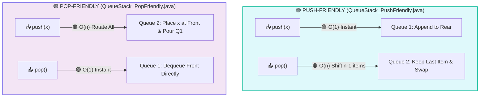
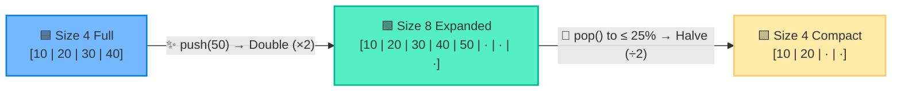
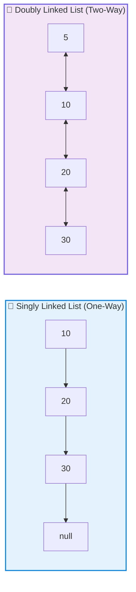

# 🎨 Data Structures & Algorithms (DSA) — データ構造とアルゴリズム


> 🌈 **Bilingual Visual Guide (`EN` / `JA`)** — Created by **Bihandu Vindiv Hettiarachchi** (`UGC0625020`) at **Lanka Nippon BizTech Institute (LNBTI)** for `CMP210130_SE06/07` (CA3 GitHub Submissions).
>
> 🌸 **バイリンガル・リポジトリ（英語・日本語）** — **Lanka Nippon BizTech Institute (LNBTI)** の講義 `CMP210130_SE06/07`（CA3課題）向けに作成した、カラフルで視覚的に学べるJavaデータ構造・アルゴリズム実装集です。

---

## 🎨 CA3 Visual Roadmap / 視覚的ロードマップ


---

## 🌐 English Version

### ✨ About This Repository

Hi, I'm **Bihandu Vindiv Hettiarachchi** (`UGC0625020`)! Welcome to [bihanduvindiv/DSA](https://github.com/bihanduvindiv/DSA)—my repository for **CA3 GitHub Submissions** in `CMP210130_SE06/07`.

Instead of plain text notes, this guide visualizes how each data structure and algorithm works in memory:
- 🎨 **Operation Trade-offs**: Choosing whether to optimize for fast writes (`Push-Friendly` / `Enqueue-Friendly`) or fast reads (`Pop-Friendly` / `Dequeue-Friendly`).
- 🌊 **Dynamic Memory Scaling (`UnboundedArrayStack`)**: Watching arrays expand (`×2`) and shrink (`÷2`) automatically so memory is never wasted.
- 🔗 **Ring Buffers & Pointer Chains (`ArrayCircularQueue`, `SinglyLinkedList`, `DoublyLinkedList`)**: Reusing fixed array slots with modulo wrap-around and linking dynamic nodes in one or both directions.

### 🖼️ Visual Diagrams: Submissions 1 & 2

#### 🎭 1. `QueueStack` — Push-Friendly vs. Pop-Friendly



#### 🌈 2. `UnboundedArrayStack` — Dynamic Resizing



#### 🔄 3. `StackQueue` — Two-Stack FIFO Pipeline


#### 🔗 4. Submission 2 — `ArrayCircularQueue`, `SinglyLinkedList` & `DoublyLinkedList`



### 🗂️ CA3 Submission Roadmap & Complexity Guide

| Milestone | Topic / Data Structure & Algorithm | Java File in Repository | Time Complexity & Key Focus | Status |
| :--- | :--- | :--- | :--- | :--- |
| **🔥 Sub 1** | **QueueStack — Push Friendly** | [QueueStack\_PushFriendly.java](https://www.google.com/search?q=https%3A%2F%2Fgithub.com%2Fbihanduvindiv%2FDSA%2Fblob%2Fmain%2FQueueStack_PushFriendly.java) | `🟢 Push: O(1)` · `🟠 Pop: O(n)` — Fast writes; shifts elements between queues only when popping. | ✅ Live |
| **🔥 Sub 1** | **QueueStack — Pop Friendly** | [QueueStack\_PopFriendly.java](https://www.google.com/search?q=https%3A%2F%2Fgithub.com%2Fbihanduvindiv%2FDSA%2Fblob%2Fmain%2FQueueStack_PopFriendly.java) | `🟠 Push: O(n)` · `🟢 Pop: O(1)` — Reorders elements on push so every pop is instant. | ✅ Live |
| **🔥 Sub 1** | **Unbounded Array Stack** | [UnboundedArrayStack.java](https://www.google.com/search?q=https%3A%2F%2Fgithub.com%2Fbihanduvindiv%2FDSA%2Fblob%2Fmain%2FUnboundedArrayStack.java) | `🟢 Amortized O(1)` — Dynamic array that doubles on overflow and halves when sparse. | ✅ Live |
| **🔥 Sub 1** | **StackQueue — Enqueue Friendly** | [StackQueue\_EnqueueFriendly.java](https://www.google.com/search?q=https%3A%2F%2Fgithub.com%2Fbihanduvindiv%2FDSA%2Fblob%2Fmain%2FStackQueue_EnqueueFriendly.java) | `🟢 Enqueue: O(1)` · `🟠 Dequeue: O(n)` — Two LIFO stacks working together as a FIFO queue. | ✅ Live |
| **🌊 Sub 2** | **StackQueue — Dequeue Friendly** | `StackQueue_DequeueFriendly.java` | `🟠 Enqueue: O(n)` · `🟢 Dequeue: O(1)` — Pre-flips stacks on insert for instant retrieval. | ⏳ Next |
| **🌊 Sub 2** | **Array Circular Queue** | [ArrayCircularQueue.java](https://www.google.com/search?q=https%3A%2F%2Fgithub.com%2Fbihanduvindiv%2FDSA%2Fblob%2Fmain%2FArrayCircularQueue.java) | `🟢 Enqueue/Dequeue: O(1)` — Modulo ring buffer (`(rear + 1) % cap`) with zero wasted space. | ✅ Live |
| **🌊 Sub 2** | **Singly Linked List** | [SinglyLinkedList.java](https://www.google.com/search?q=https%3A%2F%2Fgithub.com%2Fbihanduvindiv%2FDSA%2Fblob%2Fmain%2FSinglyLinkedList.java) | `🟢 Head: O(1)` · `🟠 Insert End / Display: O(n)` — Dynamic chain of nodes linked by forward pointers. | ✅ Live |
| **🌊 Sub 2** | **Doubly Linked List** | [DoublyLinkedList.java](https://www.google.com/search?q=https%3A%2F%2Fgithub.com%2Fbihanduvindiv%2FDSA%2Fblob%2Fmain%2FDoublyLinkedList.java) | `🟢 Head/Tail Insert: O(1)` — Two-way node list (`prev` ⇄ `next`) supporting forward and backward display. | ✅ Live |
| **🔮 Sub 3** | **Circular Doubly Linked List** | `CircularDoublyLinkedList.java` | `🟢 Ends: O(1)` — Continuous bidirectional loop connecting the tail back to the head. | ⏳ Planned |
| **🔮 Sub 3** | **Linked List Stack** | `LinkedListStack.java` | `🟢 Push/Pop: O(1)` — Pointer-based LIFO stack with no array resizing overhead. | ⏳ Planned |
| **🔮 Sub 3** | **Linked List FIFO Queue** | `LinkedListFIFOQueue.java` | `🟢 Enqueue/Dequeue: O(1)` — Pointer-based queue anchored at `front` and `rear`. | ⏳ Planned |
| **🔮 Sub 3** | **Rabbit Problem** | `RabbitProblem.java` | `🟠 Iterative: O(n)` — Fibonacci population growth sequence modeled in Java. | ⏳ Planned |
| **🧡 Sub 4** | **Hanoi Tower** | `HanoiTower.java` | `🔴 Moves: O(2ⁿ)` — Recursive solver moving $n$ disks across three pegs in $2^n - 1$ steps. | ⏳ Planned |
| **🧡 Sub 4** | **Bubble Sort Algorithm** | `BubbleSort.java` | `🔴 Time: O(n²)` — Adjacent-pair comparisons moving the largest values to the end. | ⏳ Planned |
| **🧡 Sub 4** | **Optimized Bubble Sort** | `OptimizedBubbleSort.java` | `🟢 Best: O(n)` · `🔴 Avg: O(n²)` — Early-exit `swapped` flag stops as soon as the array is sorted. | ⏳ Planned |
| **🧡 Sub 4** | **Insertion Sort Algorithm** | `InsertionSort.java` | `🟢 Best: O(n)` · `🔴 Avg: O(n²)` — Inserts each element into its proper position in the sorted left subarray. | ⏳ Planned |
| **⚡ Sub 5** | **Optimized Insertion Sort** | `OptimizedInsertionSort.java` | `🔴 Shifts: O(n²)` — Replaces full swaps with fast element shifting. | ⏳ Planned |
| **⚡ Sub 5** | **Selection Sort Algorithm** | `SelectionSort.java` | `🔴 Time: O(n²)` · `🟠 Swaps: O(n)` — Selects the minimum remaining element in each pass. | ⏳ Planned |
| **⚡ Sub 5** | **Merge Sort Algorithm** | `MergeSort.java` | `🔵 Guaranteed: O(n log n)` — Recursive divide-and-conquer stable merge sort. | ⏳ Planned |
| **⚡ Sub 5** | **Quick Sort Algorithm** | `QuickSort.java` | `🔵 Avg: O(n log n)` — Fast in-place partitioning around a pivot. | ⏳ Planned |
| **🌸 Sub 6** | **Optimized Quick Sort** | `OptimizedQuickSort.java` | `🔵 Time: O(n log n)` — Improved pivot selection to avoid $O(n^2)$ worst-case performance. | ⏳ Planned |
| **🌸 Sub 6** | **Binary Search Tree (BST)** | `BinarySearchTree.java` | `🟡 Avg: O(log n)` — Ordered binary tree with In-Order, Pre-Order & Post-Order traversals. | ⏳ Planned |
| **🌸 Sub 6** | **AVL Tree** | `AVLTree.java` | `🟡 Strict: O(log n)` — Self-balancing BST using LL, RR, LR, and RL rotations. | ⏳ Planned |

### 💻 How to Compile & Run

```bash
# 1. Clone the repository
git clone https://github.com/bihanduvindiv/DSA.git
cd DSA

# 2. Compile any Java file (e.g., DoublyLinkedList.java)
javac DoublyLinkedList.java

# 3. Run the program
java DoublyLinkedList
```

---

## 🇯🇵 日本語版 (Japanese Version)

### ✨ リポジトリの概要

はじめまして、**Bihandu Vindiv Hettiarachchi（ビハンドゥ・ヴィンディヴ・ヘッティアラッチ / 学籍番号: `UGC0625020`）**です！
このリポジトリ（[bihanduvindiv/DSA](https://github.com/bihanduvindiv/DSA)）は、**Lanka Nippon BizTech Institute (LNBTI)** の講義 `CMP210130_SE06/07` における **CA3 GitHub提出課題** のJava実装を、カラフルな図解とともに分かりやすくまとめたものです。

### 🖼️ カラフル図解：第1回・第2回課題の仕組み


### 🗂️ CA3 全6回 課題一覧＆計算量ガイド

| 提出回 | アルゴリズム・データ構造 | ソースコード | 計算量と実装のポイント | ステータス |
| :--- | :--- | :--- | :--- | :--- |
| **🔥 第1回** | **QueueStack（Push優先型）** | [QueueStack\_PushFriendly.java](https://www.google.com/search?q=https%3A%2F%2Fgithub.com%2Fbihanduvindiv%2FDSA%2Fblob%2Fmain%2FQueueStack_PushFriendly.java) | `🟢 Push: O(1)` · `🟠 Pop: O(n)` — 2つのキューでLIFOを構築し、書き込み速度を最大化。 | ✅ 完了 |
| **🔥 第1回** | **QueueStack（Pop優先型）** | [QueueStack\_PopFriendly.java](https://www.google.com/search?q=https%3A%2F%2Fgithub.com%2Fbihanduvindiv%2FDSA%2Fblob%2Fmain%2FQueueStack_PopFriendly.java) | `🟠 Push: O(n)` · `🟢 Pop: O(1)` — 追加時に順序を整え、読み出しを即座に実行。 | ✅ 完了 |
| **🔥 第1回** | **可変長配列スタック (Unbounded Array Stack)** | [UnboundedArrayStack.java](https://www.google.com/search?q=https%3A%2F%2Fgithub.com%2Fbihanduvindiv%2FDSA%2Fblob%2Fmain%2FUnboundedArrayStack.java) | `🟢 ならし O(1)` — データの増減に合わせて配列サイズを動的に拡大・縮小。 | ✅ 完了 |
| **🔥 第1回** | **StackQueue（Enqueue優先型）** | [StackQueue\_EnqueueFriendly.java](https://www.google.com/search?q=https%3A%2F%2Fgithub.com%2Fbihanduvindiv%2FDSA%2Fblob%2Fmain%2FStackQueue_EnqueueFriendly.java) | `🟢 Enqueue: O(1)` · `🟠 Dequeue: O(n)` — 2つのスタックを組み合わせてFIFOキューを実現。 | ✅ 完了 |
| **🌊 第2回** | **StackQueue（Dequeue優先型）** | `StackQueue_DequeueFriendly.java` | `🟠 Enqueue: O(n)` · `🟢 Dequeue: O(1)` — 取り出しを最速化した2スタック構成。 | ⏳ 次回 |
| **🌊 第2回** | **循環配列キュー (ArrayCircularQueue)** | [ArrayCircularQueue.java](https://www.google.com/search?q=https%3A%2F%2Fgithub.com%2Fbihanduvindiv%2FDSA%2Fblob%2Fmain%2FArrayCircularQueue.java) | `🟢 追加/削除: O(1)` — 剰余演算（`%`）で配列の先頭と末尾を繋ぐリングバッファ。 | ✅ 完了 |
| **🌊 第2回** | **単方向連結リスト (SinglyLinkedList)** | [SinglyLinkedList.java](https://www.google.com/search?q=https%3A%2F%2Fgithub.com%2Fbihanduvindiv%2FDSA%2Fblob%2Fmain%2FSinglyLinkedList.java) | `🟢 先頭: O(1)` · `🟠 末尾挿入/表示: O(n)` — ポインタで一方向に繋がる基本的な連結リスト。 | ✅ 完了 |
| **🌊 第2回** | **双方向連結リスト (DoublyLinkedList)** | [DoublyLinkedList.java](https://www.google.com/search?q=https%3A%2F%2Fgithub.com%2Fbihanduvindiv%2FDSA%2Fblob%2Fmain%2FDoublyLinkedList.java) | `🟢 先頭/末尾挿入: O(1)` — 前後ポインタ（`prev` ⇄ `next`）による順方向・逆方向表示対応リスト。 | ✅ 完了 |
| **🔮 第3回** | **循環双方向連結リスト (CircularDoublyLinkedList)** | `CircularDoublyLinkedList.java` | `🟢 両端: O(1)` — 先頭と末尾を双方向に連結した循環リスト。 | ⏳ 予定 |
| **🔮 第3回** | **連結リストスタック (LinkedListStack)** | `LinkedListStack.java` | `🟢 Push/Pop: O(1)` — サイズ制限のないポインタ型LIFOスタック。 | ⏳ 予定 |
| **🔮 第3回** | **連結リストFIFOキュー (LinkedListFIFOQueue)** | `LinkedListFIFOQueue.java` | `🟢 Enqueue/Dequeue: O(1)` — `front` と `rear` ポインタを用いた高速キュー。 | ⏳ 予定 |
| **🔮 第3回** | **ウサギの繁殖問題 (Rabbit Problem)** | `RabbitProblem.java` | `🟠 反復: O(n)` — フィボナッチ数列を用いた個体数増加モデル。 | ⏳ 予定 |
| **🧡 第4回** | **ハノイの塔 (Hanoi Tower)** | `HanoiTower.java` | `🔴 手数: O(2ⁿ)` — 再帰呼び出しで $n$ 枚の円盤を $2^n - 1$ 手で移動。 | ⏳ 予定 |
| **🧡 第4回** | **バブルソート (Bubble Sort)** | `BubbleSort.java` | `🔴 計算量: O(n²)` — 隣り合う要素を比較・交換して整列する基本ソート。 | ⏳ 予定 |
| **🧡 第4回** | **改良版バブルソート (Optimized Bubble Sort)** | `OptimizedBubbleSort.java` | `🟢 最良: O(n)` · `🔴 平均: O(n²)` — 整列完了を検知して早期終了するバブルソート。 | ⏳ 予定 |
| **🧡 第4回** | **挿入ソート (Insertion Sort)** | `InsertionSort.java` | `🟢 最良: O(n)` · `🔴 平均: O(n²)` — 整列済み部分へ要素を順番に挿入するソート。 | ⏳ 予定 |
| **⚡ 第5回** | **改良版挿入ソート (Optimized Insertion Sort)** | `OptimizedInsertionSort.java` | `🔴 シフト: O(n²)` — 不要な交換を省き、シフト操作で高速化した挿入ソート。 | ⏳ 予定 |
| **⚡ 第5回** | **選択ソート (Selection Sort)** | `SelectionSort.java` | `🔴 計算量: O(n²)` · `🟠 交換: O(n)` — 最小値を見つけて先頭から確定させるソート。 | ⏳ 予定 |
| **⚡ 第5回** | **マージソート (Merge Sort)** | `MergeSort.java` | `🔵 常に: O(n log n)` — 分割統治法による高速かつ安定なソートアルゴリズム。 | ⏳ 予定 |
| **⚡ 第5回** | **クイックソート (Quick Sort)** | `QuickSort.java` | `🔵 平均: O(n log n)` — ピボットを軸に分割統治を行う高速ソート。 | ⏳ 予定 |
| **🌸 第6回** | **改良版クイックソート (Optimized Quick Sort)** | `OptimizedQuickSort.java` | `🔵 計算量: O(n log n)` — ピボット選択の工夫で最悪ケース $O(n^2)$ を回避。 | ⏳ 予定 |
| **🌸 第6回** | **二分探索木 (Binary Search Tree)** | `BinarySearchTree.java` | `🟡 平均: O(log n)` — 挿入・探索・削除と3種の木走査アルゴリズム。 | ⏳ 予定 |
| **🌸 第6回** | **AVL木 (AVL Tree)** | `AVLTree.java` | `🟡 厳密: O(log n)` — 回転操作（LL, RR, LR, RL）で高さを自動平衡化する二分探索木。 | ⏳ 予定 |

---

### 👤 作成者プロフィール / Author Profile

| 🎨 Field | ✨ Details |
| :--- | :--- |
| **👨‍💻 Name / 氏名** | **Bihandu Vindiv Hettiarachchi**（ビハンドゥ・ヴィンディヴ・ヘッティアラッチ） |
| **🆔 Student ID / 学籍番号** | `UGC0625020` |
| **🏛️ Institute / 所属** | **Lanka Nippon BizTech Institute (LNBTI)** |
| **📘 Course / 科目** | `CMP210130_SE06/07` — Data Structures and Algorithms (CA3) |
| **🌐 GitHub** | [@bihanduvindiv](https://github.com/bihanduvindiv) · [bihanduvindiv/DSA](https://github.com/bihanduvindiv/DSA) |
