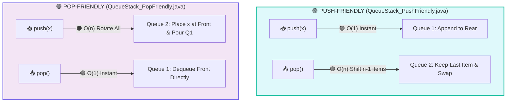
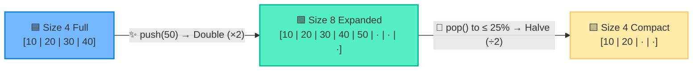
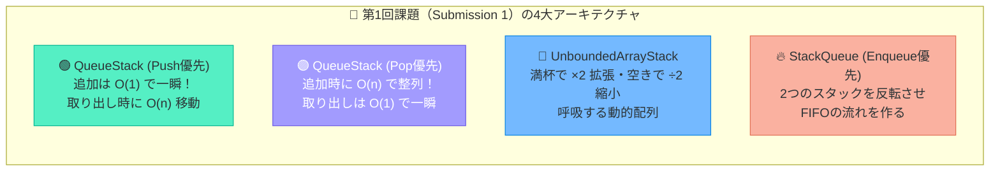

# 🎨 Data Structures & Algorithms (DSA) — データ構造とアルゴリズム


> 🌈 **Where Code Meets Visual Art (`EN` / `JA`)** — Crafted by **Bihandu Vindiv Hettiarachchi** (`UGC0625020`) at **Lanka Nippon BizTech Institute (LNBTI)** for `CMP210130_SE06/07` (CA3 GitHub Submissions).
>
> 🌸 **コードと視覚デザインの融合（英語・日本語）** — **Lanka Nippon BizTech Institute (LNBTI)** の講義 `CMP210130_SE06/07`（CA3課題）向けに作成した、カラフルで直感的に学べるJavaデータ構造・アルゴリズム実装集です。

---

## 🎨 Visual Journey & CA3 Color Map / 視覚的ロードマップ


---

## 🌐 English Studio

### ✨ About This Repository

Hi, I'm **Bihandu Vindiv Hettiarachchi** (`UGC0625020`)! Welcome to [bihanduvindiv/DSA](https://github.com/bihanduvindiv/DSA)—my creative space for **CA3 GitHub Submissions** in `CMP210130_SE06/07`.

Every algorithm has its own rhythm and shape: stacks build vertical towers, circular queues spin like color wheels, and AVL trees balance themselves like living sculptures. Instead of dry notes, this guide turns every submission into a colorful, visual story:
- 🎨 **Rhythm of Operations**: Choosing whether to invest effort upfront (`Pop-Friendly` / `Dequeue-Friendly`) or on demand (`Push-Friendly` / `Enqueue-Friendly`).
- 🌊 **Breathing Memory (`UnboundedArrayStack`)**: Watching arrays expand (`×2`) and contract (`÷2`) smoothly like a living canvas.

### 🖼️ Interactive Blueprints: Submission 1 in Color

#### 🎭 1. `QueueStack` — The Two-Queue Choreography



#### 🌈 2. `UnboundedArrayStack` — Elastic Memory Canvas



#### 🔄 3. `StackQueue` — Double-Flip FIFO Alchemy


### 🗂️ Complete CA3 Gallery & Complexity Palette

| Milestone | Artwork / Data Structure & Algorithm | Java Source Canvas | Complexity & Artistic Design Note | Status |
| :--- | :--- | :--- | :--- | :--- |
| **🔥 Sub 1** | **QueueStack — Push Friendly** | [QueueStack\_PushFriendly.java](https://www.google.com/search?q=https://github.com/bihanduvindiv/DSA/blob/main/QueueStack_PushFriendly.java) | `🟢 Push: O(1)` · `🟠 Pop: O(n)` — Fast brush-stroke writes; shifts queues only when popping. | ✅ Live |
| **🔥 Sub 1** | **QueueStack — Pop Friendly** | [QueueStack\_PopFriendly.java](https://www.google.com/search?q=https://github.com/bihanduvindiv/DSA/blob/main/QueueStack_PopFriendly.java) | `🟠 Push: O(n)` · `🟢 Pop: O(1)` — Arranges elements on arrival so every pop is effortless. | ✅ Live |
| **🔥 Sub 1** | **Unbounded Array Stack** | [UnboundedArrayStack.java](https://www.google.com/search?q=https://github.com/bihanduvindiv/DSA/blob/main/UnboundedArrayStack.java) | `🟢 Amortized O(1)` — Breathing array that doubles on overflow and halves when sparse. | ✅ Live |
| **🔥 Sub 1** | **StackQueue — Enqueue Friendly** | [StackQueue\_EnqueueFriendly.java](https://www.google.com/search?q=https://github.com/bihanduvindiv/DSA/blob/main/StackQueue_EnqueueFriendly.java) | `🟢 Enqueue: O(1)` · `🟠 Dequeue: O(n)` — Two LIFO towers working together as a FIFO stream. | ✅ Live |
| **🌊 Sub 2** | **StackQueue — Dequeue Friendly** | `StackQueue_DequeueFriendly.java` | `🟠 Enqueue: O(n)` · `🟢 Dequeue: O(1)` — Pre-flips stacks on insert for instant retrieval. | ⏳ Next |
| **🌊 Sub 2** | **Array Circular Queue** | `ArrayCircularQueue.java` | `🟢 Enqueue/Dequeue: O(1)` — Seamless modulo ring (`(rear + 1) % cap`) with zero wasted space. | ⏳ Next |
| **🌊 Sub 2** | **Singly Linked List** | `SinglyLinkedList.java` | `🟢 Head: O(1)` · `🟠 Traversal: O(n)` — Flowing chain of nodes linked by forward arrows. | ⏳ Next |
| **🌊 Sub 2** | **Doubly Linked List** | `DoublyLinkedList.java` | `🟢 Ends: O(1)` — Two-way ribbon (`prev` ⇄ `next`) allowing graceful forward and backward walks. | ⏳ Next |
| **🔮 Sub 3** | **Circular Doubly Linked List** | `CircularDoublyLinkedList.java` | `🟢 Ends: O(1)` — Infinite bidirectional loop where the tail embraces the head. | ⏳ Planned |
| **🔮 Sub 3** | **Linked List Stack** | `LinkedListStack.java` | `🟢 Push/Pop: O(1)` — Pure pointer-driven vertical tower with no array boundaries. | ⏳ Planned |
| **🔮 Sub 3** | **Linked List FIFO Queue** | `LinkedListFIFOQueue.java` | `🟢 Enqueue/Dequeue: O(1)` — Smooth pointer stream anchored at `front` and `rear`. | ⏳ Planned |
| **🔮 Sub 3** | **Rabbit Problem** | `RabbitProblem.java` | `🟠 Iterative: O(n)` — Golden-ratio Fibonacci growth modeled in Java. | ⏳ Planned |
| **🧡 Sub 4** | **Hanoi Tower** | `HanoiTower.java` | `🔴 Moves: O(2ⁿ)` — Recursive symmetry moving $n$ disks in $2^n - 1$ steps. | ⏳ Planned |
| **🧡 Sub 4** | **Bubble Sort Algorithm** | `BubbleSort.java` | `🔴 Time: O(n²)` — Gentle wave comparisons floating largest numbers to the surface. | ⏳ Planned |
| **🧡 Sub 4** | **Optimized Bubble Sort** | `OptimizedBubbleSort.java` | `🟢 Best: O(n)` · `🔴 Avg: O(n²)` — Smart `swapped` sensor stops the moment order is reached. | ⏳ Planned |
| **🧡 Sub 4** | **Insertion Sort Algorithm** | `InsertionSort.java` | `🟢 Best: O(n)` · `🔴 Avg: O(n²)` — Arranging cards by hand into a growing sorted gallery. | ⏳ Planned |
| **⚡ Sub 5** | **Optimized Insertion Sort** | `OptimizedInsertionSort.java` | `🔴 Shifts: O(n²)` — Fluid sliding movements replacing heavy three-step swaps. | ⏳ Planned |
| **⚡ Sub 5** | **Selection Sort Algorithm** | `SelectionSort.java` | `🔴 Time: O(n²)` · `🟠 Swaps: O(n)` — Finding the smallest gem in each pass and locking it in place. | ⏳ Planned |
| **⚡ Sub 5** | **Merge Sort Algorithm** | `MergeSort.java` | `🔵 Guaranteed: O(n log n)` — Recursive splitting and harmonious weaving of sorted halves. | ⏳ Planned |
| **⚡ Sub 5** | **Quick Sort Algorithm** | `QuickSort.java` | `🔵 Avg: O(n log n)` — Sculpting arrays around a central pivot in place. | ⏳ Planned |
| **🌸 Sub 6** | **Optimized Quick Sort** | `OptimizedQuickSort.java` | `🔵 Time: O(n log n)` — Balanced pivot artistry that avoids $O(n^2)$ pitfalls. | ⏳ Planned |
| **🌸 Sub 6** | **Binary Search Tree (BST)** | `BinarySearchTree.java` | `🟡 Avg: O(log n)` — Branching botanical hierarchy with In-Order, Pre-Order & Post-Order walks. | ⏳ Planned |
| **🌸 Sub 6** | **AVL Tree** | `AVLTree.java` | `🟡 Strict: O(log n)` — Self-balancing bonsai tree using LL, RR, LR, and RL rotations. | ⏳ Planned |

### 💻 Run the Art in Your Terminal

```bash
# 🎨 1. Clone the repository
git clone https://github.com/bihanduvindiv/DSA.git
cd DSA

# ⚡ 2. Compile any Java creation
javac UnboundedArrayStack.java

# 🚀 3. Watch it run
java UnboundedArrayStack
```

---

## 🇯🇵 日本語スタジオ (Japanese Studio)

### ✨ リポジトリのコンセプト

はじめまして、**Bihandu Vindiv Hettiarachchi（ビハンドゥ・ヴィンディヴ・ヘッティアラッチ / 学籍番号: `UGC0625020`）**です！
このリポジトリ（[bihanduvindiv/DSA](https://github.com/bihanduvindiv/DSA)）は、**Lanka Nippon BizTech Institute (LNBTI)** の講義 `CMP210130_SE06/07` における **CA3 GitHub提出課題** を、**「アーティストの視点で視覚的・直感的に楽しむ」** ことをテーマにデザインしたJava実装コレクションです。

### 🖼️ カラフル図解：第1回課題（Submission 1）のアート構造



### 🗂️ CA3 全6回 ギャラリー＆計算量パレット

| 提出回 | アルゴリズム・データ構造 | ソースコード | 計算量とデザインの特徴 | ステータス |
| :--- | :--- | :--- | :--- | :--- |
| **🔥 第1回** | **QueueStack（Push優先型）** | [QueueStack\_PushFriendly.java](https://www.google.com/search?q=https://github.com/bihanduvindiv/DSA/blob/main/QueueStack_PushFriendly.java) | `🟢 Push: O(1)` · `🟠 Pop: O(n)` — 2つのキューでLIFOを構築し、書き込み速度を最大化。 | ✅ 完了 |
| **🔥 第1回** | **QueueStack（Pop優先型）** | [QueueStack\_PopFriendly.java](https://www.google.com/search?q=https://github.com/bihanduvindiv/DSA/blob/main/QueueStack_PopFriendly.java) | `🟠 Push: O(n)` · `🟢 Pop: O(1)` — 追加時に美しく整列させ、読み出しを即座に実行。 | ✅ 完了 |
| **🔥 第1回** | **可変長配列スタック (Unbounded Array Stack)** | [UnboundedArrayStack.java](https://www.google.com/search?q=https://github.com/bihanduvindiv/DSA/blob/main/UnboundedArrayStack.java) | `🟢 ならし O(1)` — データの増減に合わせてキャンバスサイズを自動伸縮。 | ✅ 完了 |
| **🔥 第1回** | **StackQueue（Enqueue優先型）** | [StackQueue\_EnqueueFriendly.java](https://www.google.com/search?q=https://github.com/bihanduvindiv/DSA/blob/main/StackQueue_EnqueueFriendly.java) | `🟢 Enqueue: O(1)` · `🟠 Dequeue: O(n)` — 2つの塔（スタック）で川の流れ（キュー）を表現。 | ✅ 完了 |
| **🌊 第2回** | **StackQueue（Dequeue優先型）** | `StackQueue_DequeueFriendly.java` | `🟠 Enqueue: O(n)` · `🟢 Dequeue: O(1)` — 取り出しを最速化した2スタック構成。 | ⏳ 次回 |
| **🌊 第2回** | **循環配列キュー (ArrayCircularQueue)** | `ArrayCircularQueue.java` | `🟢 追加/削除: O(1)` — 剰余演算（`%`）で輪のように繋がるリングバッファ。 | ⏳ 次回 |
| **🌊 第2回** | **単方向連結リスト (SinglyLinkedList)** | `SinglyLinkedList.java` | `🟢 先頭: O(1)` · `🟠 探索: O(n)` — ポインタの矢印が一方向に繋がるノードの鎖。 | ⏳ 次回 |
| **🌊 第2回** | **双方向連結リスト (DoublyLinkedList)** | `DoublyLinkedList.java` | `🟢 両端: O(1)` — 前後（`prev` ⇄ `next`）を自在に行き来できる双方向リボン。 | ⏳ 次回 |
| **🔮 第3回** | **循環双方向連結リスト (CircularDoublyLinkedList)** | `CircularDoublyLinkedList.java` | `🟢 両端: O(1)` — 先頭と末尾が永遠に繋がる循環双方向リング。 | ⏳ 予定 |
| **🔮 第3回** | **連結リストスタック (LinkedListStack)** | `LinkedListStack.java` | `🟢 Push/Pop: O(1)` — サイズ制限のないしなやかなポインタ型スタック。 | ⏳ 予定 |
| **🔮 第3回** | **連結リストFIFOキュー (LinkedListFIFOQueue)** | `LinkedListFIFOQueue.java` | `🟢 Enqueue/Dequeue: O(1)` — `front` と `rear` を結ぶ高速ポインタキュー。 | ⏳ 予定 |
| **🔮 第3回** | **ウサギの繁殖問題 (Rabbit Problem)** | `RabbitProblem.java` | `🟠 反復: O(n)` — 自然界の黄金比（フィボナッチ数列）を描く生命モデル。 | ⏳ 予定 |
| **🧡 第4回** | **ハノイの塔 (Hanoi Tower)** | `HanoiTower.java` | `🔴 手数: O(2ⁿ)` — 再帰の美学で $n$ 枚の円盤を $2^n - 1$ 手で移すパズル。 | ⏳ 予定 |
| **🧡 第4回** | **バブルソート (Bubble Sort)** | `BubbleSort.java` | `🔴 計算量: O(n²)` — 泡が浮かぶように隣同士を交換して整列。 | ⏳ 予定 |
| **🧡 第4回** | **改良版バブルソート (Optimized Bubble Sort)** | `OptimizedBubbleSort.java` | `🟢 最良: O(n)` · `🔴 平均: O(n²)` — 整列完了を検知して即座にストップする賢いバブルソート。 | ⏳ 予定 |
| **🧡 第4回** | **挿入ソート (Insertion Sort)** | `InsertionSort.java` | `🟢 最良: O(n)` · `🔴 平均: O(n²)` — トランプの手札を並べるように美しい順序を構築。 | ⏳ 予定 |
| **⚡ 第5回** | **改良版挿入ソート (Optimized Insertion Sort)** | `OptimizedInsertionSort.java` | `🔴 シフト: O(n²)` — 無駄な交換を省き、滑らかなシフト操作で高速化。 | ⏳ 予定 |
| **⚡ 第5回** | **選択ソート (Selection Sort)** | `SelectionSort.java` | `🔴 計算量: O(n²)` · `🟠 交換: O(n)` — 最小の宝石を見つけて順番に並べるソート。 | ⏳ 予定 |
| **⚡ 第5回** | **マージソート (Merge Sort)** | `MergeSort.java` | `🔵 常に: O(n log n)` — 分割と調和（マージ）で常に高速な安定ソート。 | ⏳ 予定 |
| **⚡ 第5回** | **クイックソート (Quick Sort)** | `QuickSort.java` | `🔵 平均: O(n log n)` — ピボットを軸に鮮やかな分割統治を行う高速ソート。 | ⏳ 予定 |
| **🌸 第6回** | **改良版クイックソート (Optimized Quick Sort)** | `OptimizedQuickSort.java` | `🔵 計算量: O(n log n)` — 偏りを防ぐピボット選択で最悪ケースを回避。 | ⏳ 予定 |
| **🌸 第6回** | **二分探索木 (Binary Search Tree)** | `BinarySearchTree.java` | `🟡 平均: O(log n)` — 枝分かれする木構造と3種の美しい走査アルゴリズム。 | ⏳ 予定 |
| **🌸 第6回** | **AVL木 (AVL Tree)** | `AVLTree.java` | `🟡 厳密: O(log n)` — 盆栽のように自ら回転（LL, RR, LR, RL）して均衡を保つ木。 | ⏳ 予定 |

---

### 👤 アーティスト＆開発者 / Creator Profile

| 🎨 Field | ✨ Details |
| :--- | :--- |
| **👨‍💻 Name / 氏名** | **Bihandu Vindiv Hettiarachchi**（ビハンドゥ・ヴィンディヴ・ヘッティアラッチ） |
| **🆔 Student ID / 学籍番号** | `UGC0625020` |
| **🏛️ Institute / 所属** | **Lanka Nippon BizTech Institute (LNBTI)** |
| **📘 Course / 科目** | `CMP210130_SE06/07` — Data Structures and Algorithms (CA3) |
| **🌐 GitHub Studio** | [@bihanduvindiv](https://github.com/bihanduvindiv) · [bihanduvindiv/DSA](https://github.com/bihanduvindiv/DSA) |
